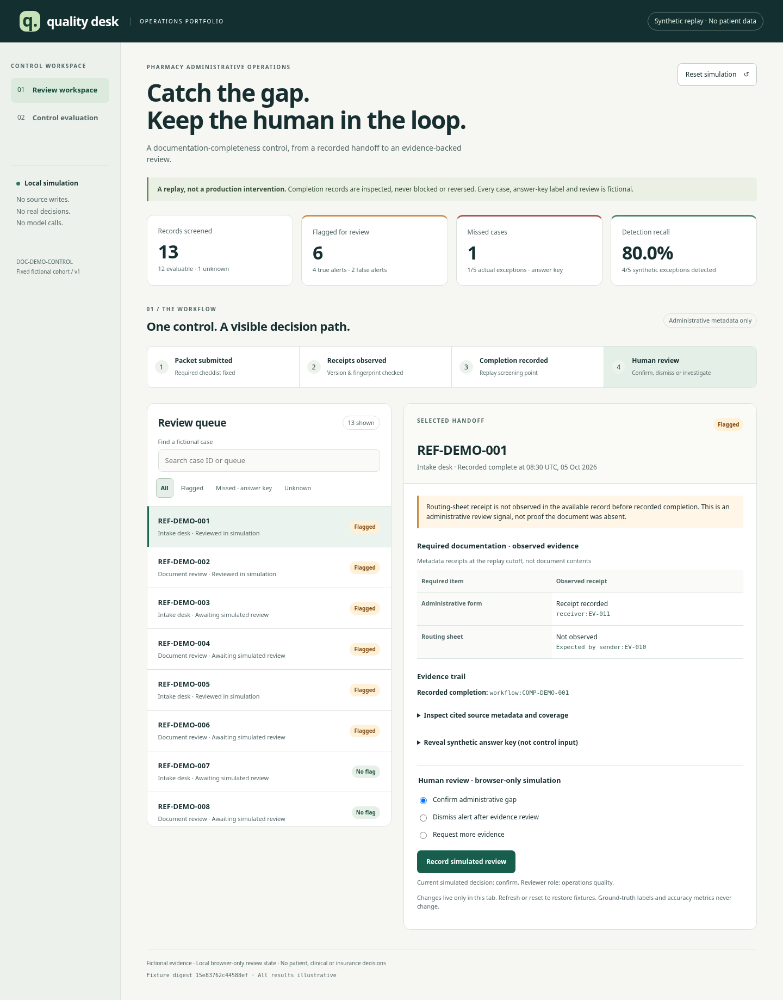

# Operational Quality Skills

An executable portfolio of **evidence-led operational quality controls**: detect administrative exceptions, investigate competing explanations, propose preventive controls, and evaluate their execution and outcomes with human oversight.

The repository contains nine installable agent skills, deterministic Python tools and fictional pharmacy, referral, retail and invoice workflows. It demonstrates an approach to quality engineering and operations leadership; it is not a deployed pharmacy system or evidence of real business results.

## Start here: review a control in four minutes



The local **Quality desk** dashboard asks whether recorded administrative completion should be reviewed when required document receipt metadata is unobserved. Inspect a case, follow its evidence, simulate a human decision and evaluate false alerts and missed cases.

**Requirements:** Git, Python 3.11+ with `venv`/pip, and a browser. Initial installation requires access to Python dependencies unless cached. Running the default demonstrations requires no credentials, Node, model, host agent or business-service connection.

On macOS/Linux, from a terminal:

```sh
git clone https://github.com/evgenytkachenko/operational-quality-skills.git
cd operational-quality-skills
python3 -m venv .venv
.venv/bin/python -m pip install .
.venv/bin/ops-pharmacy-dashboard
```

Open **http://127.0.0.1:8765**. Stop with Ctrl+C. If the port is busy, append `--port 0` and open the printed loopback address. Already cloned? Start with `cd` into that checkout. On Windows, create the environment with `py -3 -m venv .venv`, then use `.venv\Scripts\python.exe` and `.venv\Scripts\ops-pharmacy-dashboard.exe` instead of the POSIX paths above.

Follow the [four-minute presenter walkthrough](docs/portfolio-walkthrough.md). No installation available? The screenshot and walkthrough show the same fixed scenario and its reproducible label ledger.

| Inspect | What it demonstrates |
|---|---|
| REF-DEMO-003 | A flag backed by submission, receipt and completion references; unobserved receipt is not proof of missing documentation |
| REF-DEMO-005 | A false alert caused by an off-system record in the fictional answer key |
| REF-DEMO-007 | A missed exception: apparently matching receipt metadata belongs to another packet in the answer key |
| REF-DEMO-013 | Unknown coverage/adjudication, excluded from accuracy denominators |

The authored cohort has **4 true positives, 2 false positives, 1 false negative, 5 true negatives and 1 unknown**. Recall is 4/5; precision is 4/6. These are hand-constructed replay results, not production or model accuracy. Review decisions are browser-memory simulations and never alter fixed labels. Control effectiveness remains **insufficient evidence**: no pilot has been approved or implemented for this control.

## Inspect the full quality workflow

For a separate fictional acknowledgment-control scenario, run the packaged end-to-end demo from the same checkout:

```sh
.venv/bin/ops-pharmacy-demo --output output/portfolio-demo
.venv/bin/ops-pharmacy-demo-review --directory output/portfolio-demo
```

Use a new output directory for a fresh run. Open `output/portfolio-demo/START-HERE.md` for the artifact map and `REPORT.md` for the readable results. Default hypotheses and approvals are scripted fixtures, not a model run or real authorization. The offline verifier checks consistency with those fixtures; it does not authenticate sources or approve a control. Its exit code is 0 on success and 2 on verification failure.

This path connects **detection → evidence-backed hypotheses → proposed control → fictional pilot validation → execution coverage → descriptive outcomes**. The acknowledgment scenario's outcomes do not validate the dashboard's different documentation control. See the [demo guide and troubleshooting](docs/pharmacy-quality-demo.md).

## Design decisions and current status

| Component | Implemented | Verification boundary |
|---|---|---|
| Deterministic Python tools | Bounded evidence, source references, coverage/unknown handling, aggregate denominators and citation checks | Synthetic tests cannot authenticate upstream records or establish causation |
| Agent investigation | Skills guide competing hypotheses, discriminating checks and preventive proposals | Human semantic review is required; valid citations do not prove a cause |
| Local LLM option | Existing Ollama adapter in workbench/demo workflows; explicit opt-in | Mocked responses tested; no model run, accuracy, memory-fit or real reasoning validation claimed |
| Source profiles | Official Datadog SDK and PostgreSQL/psycopg read profiles for supported core workflows | Live tenants, permissions and schemas unvalidated; domain auditors are mock-only |
| Human oversight | Review gates and separate proposal, implementation, coverage and effectiveness evidence | No automatic rollout, clinical/insurance decisions, source writes or notifications |

The dashboard has no model invocation path. See [workbench execution modes](skills/pharmacy-improvement-workbench/references/workflow.md) and [integration/security limits](skills/operations-root-cause/references/integrations.md) before evaluating optional paths. Do not supply PHI or real records to these demonstrations. Keep the local demo server on loopback; it is not an authenticated production application.

## Explore the implementation

The [skill and CLI reference](docs/cli-reference.md) preserves installation and per-tool examples. The nine skills cover monitoring, root-cause investigation, control validation, process conformance, pharmacy handoffs, store handoffs, referral packets, pharmacy improvement and control execution coverage. The [reuse decisions](docs/reuse.md) explain architectural and licensing boundaries.

To run the synthetic test suite in the same environment:

```sh
.venv/bin/python -m pip install '.[test]'
.venv/bin/python -m pytest -q
```

See [dashboard/browser verification](docs/pharmacy-dashboard-verification.md) and [first-run verification](docs/portfolio-first-run-verification.md). Automated accessibility checks are not WCAG certification. No live pharmacy outcomes, deployment, clinical safety, causal improvement or model quality are established by this project.
