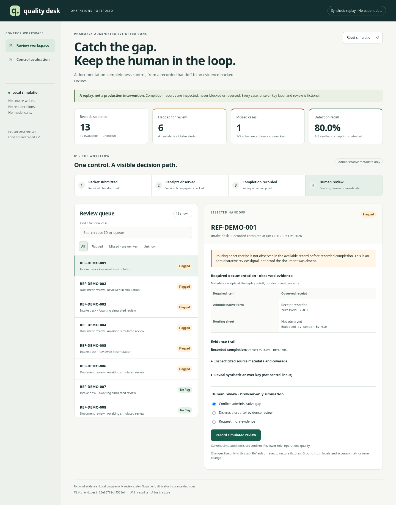

# Quality desk: fictional pharmacy control portfolio

A desktop/mobile portfolio demonstration of one administrative control: **review a recorded completion when required document receipt metadata is unobserved**. This is a replay that illustrates a possible preventive checkpoint. It never blocks, reverses or completes a real handoff. All records, document fingerprints, answer-key labels and initial review decisions are authored synthetic fixtures.

## Launch locally

From a Python 3.11+ repository checkout:

```sh
python -m venv .venv
.venv/bin/python -m pip install .
.venv/bin/ops-pharmacy-dashboard
```

Open **http://127.0.0.1:8765** in a browser. Stop the server with Ctrl+C. If the port is occupied, use `--port 8766`; `--port 0` chooses an available port and prints its address. The server binds only to `127.0.0.1`. No credentials, Node build step, external fonts, model or service are required. The installed wheel includes the HTML, CSS and JavaScript, so launch works outside the checkout.

This is a local Python demonstration server, not a production deployment or authenticated application. Do not expose it through a public tunnel, bind a public listener, supply real data or use its decisions operationally. There are no write endpoints or uploaded-data inputs.

## Preview



[Mobile screenshot](images/dashboard-mobile.png)

## Present the demo

Use the [four-minute portfolio walkthrough](portfolio-walkthrough.md) for a presenter narrative, case-level label ledger and reproducible evidence audit.

## Fixed synthetic ground truth and calculations

| Count | Value | Meaning |
|---|---:|---|
| True positives | 4 | Flagged and documentation actually missing in the authored answer key |
| False positives | 2 | Flagged, but documentation present according to the answer key |
| False negatives | 1 | No flag despite missing documentation in the answer key |
| True negatives | 5 | No flag and documentation present in the answer key |
| Unknown | 1 | Unusable coverage/adjudication; excluded from all four rates |

Precision = 4/6 = **66.7%**. Recall = 4/5 = **80%**. False-positive rate = 2/7 actual negatives = **28.6%** (not 2/6 flags). Miss rate = 1/5 actual exceptions = **20%**. Counts are explicitly labeled synthetic and remain unchanged by simulated reviewer decisions. Zero denominators produce unavailable rates, not zero accuracy.

The 12-case evaluable cohort is hand-authored, not randomly sampled or representative. The truth labels are neither independent real adjudication nor clinical judgments. Unknown exclusion is displayed, not hidden. No statistical confidence, generalization, real-world performance or improvement claim is made.

## Architecture and reuse

`dashboard.py` builds bounded fictional metadata and calls the existing **Referral Packet Auditor** for administrative form/routing-sheet receipt checks. The candidate control gates review on those findings at an authored recorded-completion point. Original mock source IDs, receipt metadata, completion refs, manifest assertions and report digests remain inspectable. Source metadata and supplied fingerprints are not authenticated document contents. The answer key is added separately after detector evaluation, never supplied to the control.

The existing **Control Validation** contract evaluates an unapproved, unimplemented proposal and returns insufficient evidence without aggregate retrieval. That output is shown separately from classifier accuracy. This dashboard complements `ops-pharmacy-demo`; it does not reuse that acknowledgment pilot's favorable rates for this different documentation control. Existing demo/validation architecture supplies evidence, hashes and human-review boundaries; no new provider, connector or clinical logic is invented.

The UI uses local static assets, native controls, semantic headings/tables, explicit labels, visible focus, a skip link, announced review status and responsive layouts. Browser state is ephemeral; there is no localStorage, cookie, external resource or analytics. All data is inserted via textContent rather than HTML interpretation. The server exposes exact fixed GET routes, a restrictive content-security policy and no source-write API.

## Verification and limitations

See [verification details](pharmacy-dashboard-verification.md). Calculations and route security have automated tests. Desktop/mobile Chromium, keyboard flows and automated accessibility checks were exercised. Automated checks do not establish full WCAG conformance or replace assistive-technology/user testing.

No model was run or downloaded. There is no dashboard model invocation path, and detector rates are not LLM accuracy. No PHI, document contents, clinical appropriateness, dosing, dispensing, urgency, consent-validity or insurance decisions are supported. Source mapping/completeness and ground truth remain fictional assertions. No real control was implemented, no clinical safety was established, and no operational outcomes were measured.
